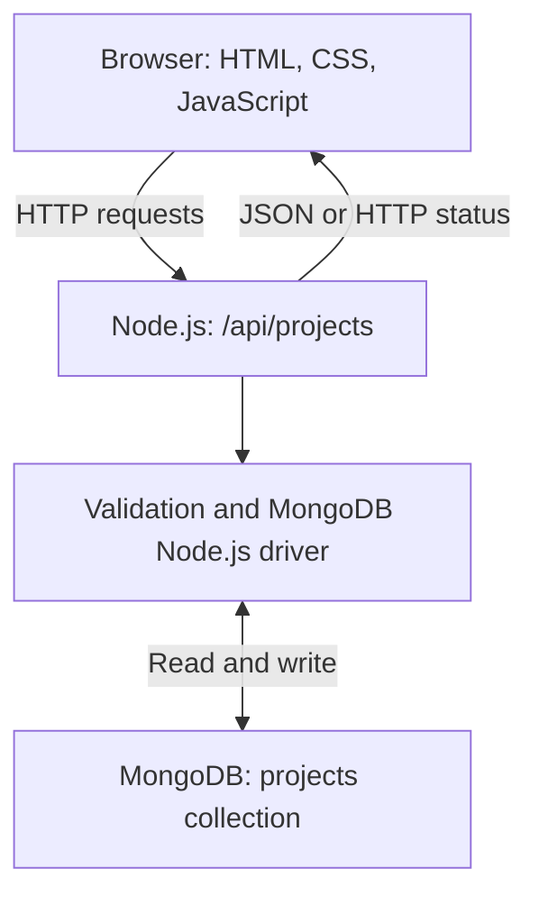

# System design draft

**Audience:** Students who need a simple way to track work across courses.  
**Goal:** Keep project deadlines and progress available across sessions.

## Use cases

The student can add a project, view saved projects, update its details or status, and delete it after confirming. The student can filter the list by status. Draw the student as the actor outside the system boundary and connect the actor to those use cases in your UML diagram.

## Architecture

## Data model

| Field | Type | Rule |
|---|---|---|
| _id | String | Server-generated UUID; exposed as id by the API |
| title | String | Required, up to 120 characters |
| course | String | Required, up to 80 characters |
| dueDate | String | Optional ISO date; empty string if omitted |
| status | String | planned, in-progress or completed; defaults to planned |
| notes | String | Optional; up to 1,500 characters |
| updatedAt | String | Server-generated ISO timestamp |

Capture evidence of a project created from the browser, an API response in Bruno, and the same record after restarting the server. Add your rationale, reference research, UI iterations and reflection as you work.
